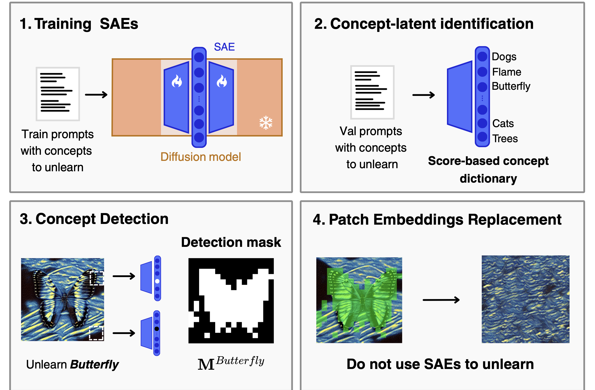

<div align="center">

<h1>PER — Patch Embedding Replacement</h1>

<p><strong>Look But Don't Touch with Sparse Autoencoders for Unlearning in Diffusion Models</strong></p>

<p>
  <a href="https://eidoslab.github.io/PER">Project Page</a> •
  <a href="https://arxiv.org/abs/2606.31699">Paper (ECCV 2026)</a>
</p>

<p>
  
  
</p>

</div>

<div align="center">
  
</div>

---

## PER Methodology

SAEs reliably **detect** where a concept lives in a diffusion model's feature map, but *steering*
those latents with negative multipliers pushes activations out of the model's training
distribution and produces severe visual artifacts.

**Patch Embedding Replacement (PER)** keeps the detection part and drops the intervention: the SAE latents are used only to build a spatial mask of concept-containing patches, and those patch embeddings are then replaced with in-distribution embeddings sampled from non-detected locations of the *same* feature map. No multiplier, no intervention-strength grid search.

---

## Repository Structure

```
PER/
├── SAE/                          # SAE architecture and hooked diffusion pipelines
├── utils/
│   ├── hooks.py                          # baseline SAE steering hooks (multiplier)
│   └── noise_injection_hooks.py          # PER hooks (patch embedding replacement)
├── UnlearnCanvas_resources/      # class / style lists and anchor prompts from UnlearnCanvas
├── scripts/
│   ├── load_from_hub.py                          # download an SAE checkpoint from HuggingFace
│   ├── efficient_gather_sae_acts_ca_prompts_cls.py   # Step 1:   concept–latent dictionary
│   ├── save_scores.py                                # Step 1:   per-concept latent scores
│   ├── efficient_sweep_cls_distr.py                  # Step 2.0: percentile/multiplier sweep
│   ├── run_acc_all_cls_sweep.py                      # Step 2.0: sweep evaluation
│   ├── accuracy_unlearncanvas_cls_sweep_fast.py
│   ├── avg_accuracy_cls_sweep.py
│   ├── find_best_params_cls_sweep.py                 # Step 2.0: writes class_params.pth
│   ├── noise_injection_sample_unlearning_cls_distr.py # Step 2.1: generation WITH PER
│   ├── sample_unlearning_cls_distr.py                # Step 2.1: generation with steering
│   ├── run_acc_all_cls.py                            # Step 3:   UA / IRA / CRA
│   ├── accuracy_unlearncanvas_cls_fast.py
│   └── avg_accuracy_cls.py
└── requirements.txt
```

---

## Setup

```bash
git clone https://github.com/EIDOSLAB/PER.git
cd PER
pip install -r requirements.txt
```

All commands below are run from the repository root.

---

## Pretrained Assets

PER is applied on top of an existing SAE pipeline, so you need that pipeline's SAE checkpoint plus the UnlearnCanvas model and classifiers. Download them wherever you prefer — every path is passed as a CLI argument.

| Asset | Source |
|-------|--------|
| SAEmnesia SAE checkpoint | [`leno3003/SAEmnesia`](https://huggingface.co/leno3003/SAEmnesia) on HuggingFace |
| UnlearnCanvas diffusion model (`style50`) | [Google Drive](https://drive.google.com/drive/folders/18tN-7LuxQ89I-MDSjtB5to2dGHDMHyqb) |
| `style50.pth` and `style50_cls.pth` (classifiers) | [Google Drive](https://drive.google.com/drive/folders/1AoazlvDgWgc3bAyHDpqlafqltmn4vm61) |
| `class_params.pth`, `cls_latents_dict_unet.up_blocks.1.attentions.1.pkl` | [Google Drive](https://drive.google.com/drive/folders/1NoFDrjJ3dYmadufV2pK203ZED2pZ_hsB?usp=sharing) |

The last row lets you skip steps 1 and 2.0 entirely and jump straight to the PER generation. Those files (`class_params.pth`, `cls_latents_dict_unet.up_blocks.1.attentions.1.pkl`) the are computed for SAEmnesia. If you use other SAE-based unlearning methodologies, you'll need to recompute them with steps 1 and 2.x.

### Downloading the UnlearnCanvas model and classifiers

```bash
gdown --folder https://drive.google.com/drive/folders/18tN-7LuxQ89I-MDSjtB5to2dGHDMHyqb \
    -O /path/to/style50

gdown --folder https://drive.google.com/drive/folders/1AoazlvDgWgc3bAyHDpqlafqltmn4vm61 \
    -O /path/to/classifiers

gdown --folder "https://drive.google.com/drive/folders/1NoFDrjJ3dYmadufV2pK203ZED2pZ_hsB?usp=sharing" \
    -O /path/to/sae_assets
```

---

## Reproducing the Main Results

Throughout: `unet.up_blocks.1.attentions.1` is the object hookpoint, `100` denoising steps and guidance scale `9.0` are the UnlearnCanvas SD v1.5 settings, and `188` is the generation seed used in the runs reported below. The multi-GPU steps are launched with `accelerate`; set `--num_processes` to your GPU count.

### Step 1 — Build the concept–latent dictionary

Runs the anchor prompts of all 20 UnlearnCanvas objects through the diffusion model, encodes the cached activations with the SAE, and saves the per-concept latent activations.

```bash
python scripts/efficient_gather_sae_acts_ca_prompts_cls.py \
    --checkpoint_path "/path/to/sae_checkpoint" \
    --hookpoint "unet.up_blocks.1.attentions.1" \
    --pipe_path "/path/to/style50" \
    --save_dir "/path/to/features_activations/unet.up_blocks.1.attentions.1" \
    --steps 100 \
    --seed 188
```

Writes `cls_latents_dict_unet.up_blocks.1.attentions.1.pkl` into `--save_dir`. 

### Step 2.0 — Per-concept `percentile` (optional)

PER does **not** tune an intervention strength: of the two fields in `class_params.pth` it reads only `percentile`, which sets how many SAE latents form the detection mask.

If you already have a `class_params.pth` (see Pretrained Assets, or one produced by the SAeUron / SAEmnesia pipelines), **skip to Step 5.1**. To recompute it from scratch, run the three phases of the sweep — this is the expensive grid search that PER removes from inference, and it is only needed here to pick the detection percentile:

```bash
# Phase 1 — generate the sweep images
accelerate launch --num_processes 4 scripts/efficient_sweep_cls_distr.py \
    --percentiles [99.99,99.995,99.999] \
    --multipliers [-1.0,-5.0,-10.0,-15.0,-20.0,-25.0,-30.0] \
    --seed 188 \
    --steps 100 \
    --guidance_scale 9.0 \
    --output_dir '/path/to/sweep/seed_188' \
    --pipe_checkpoint '/path/to/style50' \
    --hookpoint 'unet.up_blocks.1.attentions.1' \
    --class_latents_path '/path/to/features_activations/unet.up_blocks.1.attentions.1/cls_latents_dict_unet.up_blocks.1.attentions.1.pkl' \
    --sae_checkpoint '/path/to/sae_checkpoint'

# Phase 2 — score every (percentile, multiplier) cell
python scripts/run_acc_all_cls_sweep.py \
    --percentiles [99.99,99.995,99.999] \
    --multipliers [-1.0,-5.0,-10.0,-15.0,-20.0,-25.0,-30.0] \
    --input_dir_base /path/to/sweep/seed_188 \
    --output_dir_base /path/to/sweep/seed_188 \
    --class_ckpt /path/to/classifiers/style50_cls.pth \
    --batch_size 256 \
    --seed 188

# Phase 3 — pick, per class, the cell maximising (UA + IRA) / 2
python scripts/find_best_params_cls_sweep.py \
    [99.99,99.995,99.999] \
    [-1.0,-5.0,-10.0,-15.0,-20.0,-25.0,-30.0] \
    "/path/to/sweep/seed_188"
```

Phase 3 writes `/path/to/sweep/seed_188/class_params.pth`.

### Step 2.1 — Generate images with PER

This is the method. `noise_mode='replace_with_neighbor_padded'` with `padding=0` replaces exactly the detected concept patches with non-detected patches drawn from the same feature map, applied across the whole denoising trajectory (`start_timestep=99` down to `end_timestep=0`). As reported as result in the paper, higher padding should lead to higher Unlearning Accuracy.

```bash
accelerate launch --num_processes 4 scripts/noise_injection_sample_unlearning_cls_distr.py \
    --seed 188 \
    --output_dir '/path/to/output/per_images' \
    --pipe_checkpoint '/path/to/style50' \
    --hookpoint 'unet.up_blocks.1.attentions.1' \
    --sae_checkpoint '/path/to/sae_checkpoint' \
    --class_latents_path '/path/to/features_activations/unet.up_blocks.1.attentions.1/cls_latents_dict_unet.up_blocks.1.attentions.1.pkl' \
    --class_params_path '/path/to/sweep/seed_188/class_params.pth' \
    --steps 100 \
    --guidance_scale 9.0 \
    --use_sae=True \
    --noise_mode='replace_with_neighbor_padded' \
    --padding=0 \ # Set this according to the experiments section of the paper.
    --start_timestep=99 \
    --end_timestep=0
```

### Step 3 — Evaluate (UA / IRA / CRA)

```bash
python scripts/run_acc_all_cls.py \
    --input_dir "/path/to/output/per_images" \
    --output_dir "/path/to/output/eval_results" \
    --style_ckpt "/path/to/classifiers/style50.pth" \
    --class_ckpt "/path/to/classifiers/style50_cls.pth" \
    --batch_size 128 \
    --seed 188
```

Classifies every generated image with the UnlearnCanvas ViT classifiers and prints **UA** (Unlearning Accuracy), **IRA** (In-domain Retention Accuracy) and **CRA** (Cross-domain Retention Accuracy). `--seed` must match the seed used at generation time, since the evaluation resolves images by filename. Per-class results are saved as `<output_dir>/<class>.pth` and `<output_dir>/<class>_cls.pth`.

## Citation

```bibtex
@article{cassano2026look,
  title={Look But Don't Touch with Sparse Autoencoders for Unlearning in Diffusion Models},
  author={Cassano, Enrico and Renzulli, Riccardo and Ahmed, Rayyan and Grangetto, Marco and Alaniz, Stephan},
  journal={arXiv preprint arXiv:2606.31699},
  year={2026}
}
```

---

## Acknowledgements

We acknowledge the CINECA award under the ISCRA initiative for the availability of high performance computing resources and support.

This work builds upon [SAeUron](https://github.com/cywinski/SAeUron) by Cywiński et al. and [SAEmnesia](https://github.com/EIDOSLAB/SAEmnesia) by Cassano et al. We thank the authors for releasing their code and pre-trained models.

---

<div align="center">
<sub>© 2026 EIDOSLab — University of Turin</sub>
</div>
